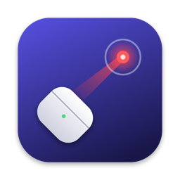

<p align="center">
  
</p>

<h1 align="center">PodPointer</h1>

<p align="center">Point your AirPods case at the screen and tap it to control your Mac.</p>

<p align="center">
  <a href="https://github.com/abhav24/PodPointer/releases/download/v0/PodPointer-v0.dmg"><strong>Download PodPointer v0</strong></a>
</p>

PodPointer turns your AirPods case into a presentation remote and an air mouse. There's nothing extra to buy, because the motion sensors in the AirPods inside the case do all the work.

> **v0 is an early release.** It's been tested on one pair of AirPods Pro 2 with an Apple silicon Mac running macOS 27. Other AirPods, Macs, and hands may behave differently, so [your test results](docs/TESTING.md) help a lot.

## What you can do

| Case | Presenter mode | Mouse mode |
|---|---|---|
| Rotate | Moves a laser dot | Moves the cursor |
| Tap | Next slide | Click |
| Double-tap | Previous slide | Double-click |
| Triple-tap | Turns the laser dot on or off | Pauses or resumes the cursor |

## Requirements

- macOS 14 or later
- AirPods that support head tracking, such as AirPods Pro
- Swift 5.10 or later, from Xcode or the Command Line Tools

## Build and run

```bash
git clone https://github.com/abhav24/PodPointer.git
cd PodPointer
scripts/build-app.sh
open build/PodPointer.app
```

Use the script rather than `swift run`, because macOS only shows the motion permission to a real app bundle.

## Set up

Open the app and follow the steps on screen. Setup takes about 5 minutes and covers:

1. Connecting your AirPods
2. Turning off **Automatic Ear Detection**, which you need to do yourself because no Shortcut or public API can change it
3. Putting the AirPods in the case with the **lid open**
4. Calibrating for your grip
5. Scored tests for tapping, single, double, and triple taps, false taps, and aiming
6. Trying real slides

You can run setup again from **Advanced**.

## Permissions and privacy

| Permission | Why it's needed | When |
|---|---|---|
| Motion & Fitness | Reads motion from your AirPods | At launch |
| Accessibility | Sends arrow keys and clicks | Only if you turn on sending |

PodPointer has no network code. It saves your calibration and settings on your Mac only. Test reports are copied to your clipboard only when you ask, and they leave out your AirPods' name.

During setup, PodPointer also records raw motion to `~/Library/Application Support/PodPointer/last-setup-motion.csv` so tap detection can be tuned against real taps. Each setup run replaces that file, and it stays on your Mac unless you share it.

## Known limits

- The lid has to stay open, and open-lid battery use hasn't been measured.
- Automatic Ear Detection has to be off.
- Calibration applies to one AirPod and one grip. If motion moves to the other AirPod, or you change your grip, calibrate again.
- A closed-lid mode would need a private Bluetooth channel, so it isn't included.

## Related projects

[PodMouse](https://github.com/0xCodez/PodMouse) and [AirPointer](https://github.com/oscarcreatess/airpointer) also turn an AirPods case into a pointer. PodPointer focuses on presenting.

## Contributing

Results from real AirPods are the most useful contribution right now. See [CONTRIBUTING.md](CONTRIBUTING.md).

## License

[MIT](LICENSE)

PodPointer is an independent project and isn't affiliated with or endorsed by Apple Inc. AirPods, Mac, and macOS are trademarks of Apple Inc.
